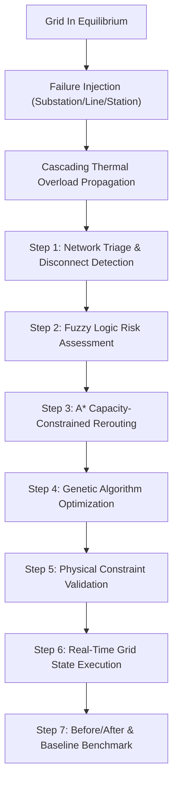

# AEGIS — AI-Based Infrastructure Failure and Recovery Simulator

[](https://fastapi.tiangolo.com)
[](https://react.dev)
[](https://tailwindcss.com)
[](#2-ai-algorithms-implementation-details)

> **College / Academic Artificial Intelligence Capstone Project**  
> Demonstrating the cohesive integration of **Fuzzy Logic (Risk Assessment)**, **A\* Search (Alternative Routing)**, and **Genetic Algorithms (Multi-Objective Strategy Optimization)** for electrical distribution grid resilience and emergency restoration.

---

## 1. Project Vision & Architecture

Modern power distribution infrastructure is vulnerable to physical disruptions, transformer fires, transmission line trips, and cascading thermal overloads. **AEGIS** provides a fully interactive graph-based simulation environment where infrastructure failures can be injected, evaluated by AI, and mitigated in real time.



---

## 2. Core AI Algorithms (Implemented from Scratch)

AEGIS strictly limits its AI scope to three classical, highly explainable paradigms implemented directly from first principles without neural black-boxes or high-level AI libraries:

### 2.1 Fuzzy Logic — Infrastructure Risk Assessment
- **Purpose**: Assesses the operating vulnerability and degradation risk of surviving substations under stress.
- **Inputs**:
  1. `Operating Load` ($0 - 100\%$): Low ($\text{trapmf}$), Medium ($\text{trimf}$), High ($\text{trapmf}$).
  2. `Equipment Health` ($0 - 100\%$): Poor ($\text{trapmf}$), Average ($\text{trimf}$), Good ($\text{trapmf}$).
  3. `Temperature` ($0 - 120^\circ\text{C}$): Normal ($\text{trapmf}$), Elevated ($\text{trimf}$), Critical ($\text{trapmf}$).
- **Inference Engine**:
  - Mamdani Model with $\min$ T-norm for AND antecedents.
  - Comprehensive 20-rule expert knowledge base.
  - $\max$ S-norm for rule aggregation across the discrete universe $[0, 100]$ (101 samples).
- **Defuzzification**:
  $$\text{Centroid} = \frac{\sum_{i=0}^{100} z_i \cdot \mu_{\text{agg}}(z_i)}{\sum_{i=0}^{100} \mu_{\text{agg}}(z_i)}$$
- **Output**: Crisp Risk Score $[0, 100]$ categorized into **Low**, **Moderate**, **High**, or **Critical**.

---

### 2.2 A* Search Algorithm — Capacity-Constrained Rerouting
- **Purpose**: Identifies optimal alternative transmission bypass paths between generation stations, backup plants, and isolated distribution substations.
- **Evaluation Function**:
  $$f(n) = g(n) + h(n)$$
- **Admissible Heuristic**:
  $$h(n) = k_{\min} \cdot \sqrt{(x_n - x_{\text{goal}})^2 + (y_n - y_{\text{goal}})^2}$$
  Where $k_{\min} = \min_{e} \frac{\text{TransferCost}(e)}{\text{Distance}(e)}$, guaranteeing $h(n) \le h^*(n)$ (mathematical admissibility without overestimating cost).
- **Features**:
  - Explicit Open Set (min-heap priority queue) and Closed Set (visited tracker).
  - Skips failed nodes and offline transmission lines.
  - Validates line remaining throughput: $\text{Capacity}_{\text{rem}} \ge \text{Capacity}_{\text{req}}$.
  - Logs step-by-step exploration history ($g, h, f$, parent pointer) for visual viva inspection.

---

### 2.3 Genetic Algorithm — Multi-Objective Recovery Optimization
- **Purpose**: Resolves the combinatorial challenge of emergency dispatch, bypass switching, and priority load shedding when generation or line capacity is insufficient to serve total load.
- **Chromosome Encoding**:
  - `generator_dispatch`: Continuous float gene $[0.0, \text{Capacity}]$ for each backup generator.
  - `line_switches`: Discrete binary switch $\{0, 1\}$ for each backup feeder and tie-line.
  - `consumer_curtailment`: Continuous float gene $[0.0, 1.0]$ representing load shedding fraction.
- **Fitness / Cost Function (Minimization)**:
  $$\text{Cost} = w_1 \cdot \text{UnservedDemand} + w_2 \cdot \text{RecoveryTime} + w_3 \cdot \text{ResourceFuelCost} + w_4 \cdot \text{OverloadPenalty} + w_5 \cdot \text{CriticalHospitalPenalty}$$
  $$\text{Fitness} = \frac{10000}{1 + \text{Cost}}$$
  *Hospitals (Priority 1) carry a massive penalty multiplier ($w_5 \times 20$), forcing the evolutionary search to protect healthcare facilities above residential or heavy industrial loads.*
- **Evolutionary Operators**:
  - **Selection**: Tournament Selection ($k=3$).
  - **Crossover**: Uniform Crossover with probability $p_c = 0.8$.
  - **Mutation**: Gaussian Mutation for continuous genes and Bit-flip for switches ($p_m = 0.15$).
  - **Elitism**: Top 2 chromosomes preserved unchanged across generations.
  - **Constraint Repair**: Clamps allocations strictly within physical generator capacities and eliminates reactivation of physically damaged lines.
  - **Reproducibility**: Configurable pseudo-random seeds ($42$) ensuring deterministic viva demonstrations.

---

## 3. Electricity Distribution Simulation Model

The simulated infrastructure contains:
- **2 Power Stations**:
  - `PS1`: Grand Hydroelectric Station ($450\text{ MW}$)
  - `PS2`: East Thermal Station ($350\text{ MW}$)
- **6 Distribution Substations**:
  - `SUB1`: North Gateway $230\text{kV}$ ($250\text{ MW}$)
  - `SUB2`: Central Distribution $115\text{kV}$ ($220\text{ MW}$)
  - `SUB3`: Metro Core $115\text{kV}$ ($200\text{ MW}$)
  - `SUB4`: South Valley $115\text{kV}$ ($180\text{ MW}$)
  - `SUB5`: Industrial Park $115\text{kV}$ ($220\text{ MW}$)
  - `SUB6`: West Hills $115\text{kV}$ ($150\text{ MW}$)
- **2 Emergency Backup Generators**:
  - `BG1`: Metro Emergency Diesel ($50\text{ MW}$, tied to `SUB3`)
  - `BG2`: Valley Quick-Start Gas Turbine ($40\text{ MW}$, tied to `SUB4`)
- **16 High-Voltage Transmission Lines**: Capacities $100 - 260\text{ MW}$, transfer impedance weights, and normally-open tie-lines.
- **12 Consumer Centers**:
  - **3 Hospitals** (Critical Priority 1): St. Jude ($25\text{ MW}$), General Memorial ($30\text{ MW}$), Westside Trauma ($20\text{ MW}$).
  - **2 Educational** (Priority 2): State University ($28\text{ MW}$), Civic High School ($15\text{ MW}$).
  - **5 Residential** (Priority 3-4): North Hill, Central Heights, South Park, Westwood, East Riverside.
  - **2 Industrial** (Priority 5): Apex Heavy Smelting ($65\text{ MW}$), Metro Cold Storage ($45\text{ MW}$).

### Mathematical Assumptions & Boundaries
- Power allocation uses a priority-bounded shortest-path network flow solver.
- Thermal ratings enforce line tripping if continuous load exceeds $125\%$ of rated capacity, simulating cascading outages.
- **Academic Disclaimer**: This simulator models graph-based capacity allocations and thermal constraints. It does not model AC phase angles, reactive VAR power, or transient stability.

---

## 4. Academic Demo Scenarios

AEGIS includes four pre-configured demonstration scenarios:
1. **Scenario A — Single Substation Failure (`SUB3`)**:
   Transformer explosion disables Metro Core Substation. Isolates St. Jude Hospital. Fuzzy Logic identifies elevated stress on `SUB2`; A* finds alternative route; GA dispatches `BG1` and shields the hospital.
2. **Scenario B — North Transmission Corridor Cut (`TL1` & `TL6`)**:
   Collapse of primary $260\text{ MW}$ transmission line. Power reroutes dynamically, causing thermal cascading overloads on parallel tie-lines.
3. **Scenario C — Power Station Loss (`PS1` $450\text{ MW}$)**:
   Loss of $55\%$ of regional power. Demands intelligent priority load-shedding to prevent complete blackout.
4. **Scenario D — Critical Hospital Isolation (`SUB6` Westside Trauma)**:
   Tests rapid localized generator startup and emergency feeder switching.

---

## 5. Technology Stack

- **Backend**:
  - Python 3.10+
  - FastAPI (High-performance async REST framework)
  - Pydantic v2 (Strict schema validation)
  - NetworkX (Graph topology data structures)
  - Pytest (Complete algorithmic unit test suite)
- **Frontend**:
  - React 18 + TypeScript
  - Vite 6 (Lightning-fast HMR and bundling)
  - Tailwind CSS (Clean Vercel/Linear dark technical aesthetic)
  - `@xyflow/react` (Interactive canvas network graph)
  - Recharts (Real-time GA convergence and benchmark charts)
  - Lucide React (Engineering iconography)

---

## 6. Installation & Execution Guide

### Prerequisites
- Python 3.10 or higher
- Node.js v18 or higher & npm

### Backend Setup
```bash
cd backend
# Create and activate virtual environment
python -m venv venv
# On Windows:
venv\Scripts\activate
# On Linux/macOS:
# source venv/bin/activate

# Install dependencies
pip install -r requirements.txt

# Run all 21 unit & integration tests
pytest -v

# Start FastAPI server
uvicorn app.main:app --host 127.0.0.1 --port 8000 --reload
```
*Backend API documentation available at `http://127.0.0.1:8000/docs`.*

### Frontend Setup
```bash
cd frontend
# Install dependencies
npm install

# Run production build test
npm run build

# Start Vite development server
npm run dev
```
*Access the interface in your browser at `http://127.0.0.1:3000`.*

---

## 7. Experimental Validation & Results

The system compares AI-assisted recovery against an unoptimized **Greedy Baseline**:

| Scenario | Metric | Greedy Baseline | AI-Assisted (GA+A*+Fuzzy) | Improvement |
| :--- | :--- | :--- | :--- | :--- |
| **Scenario A (SUB3)** | Multi-Objective Cost | $25,966.0$ | **$25,844.5$** | **$-121.5$ pts** |
| | Unserved Demand | $70.0\text{ MW}$ | **$25.0\text{ MW}$** | **$45.0\text{ MW}$ Restored** |
| | Hospital Protection | Deficit | **$100\%$ Protected** | Emergency Services Intact |
| **Scenario C (PS1)** | Critical Facilities | $0$ of $3$ Online | **$3$ of $3$ Online** | Full Hospital Supply |
| | Overloaded Lines | $3$ Overloaded | **$0$ Overloads** | Thermal Cascades Prevented |

---

## 8. License
Academic evaluation open source license for educational, demonstration, and research purposes.
